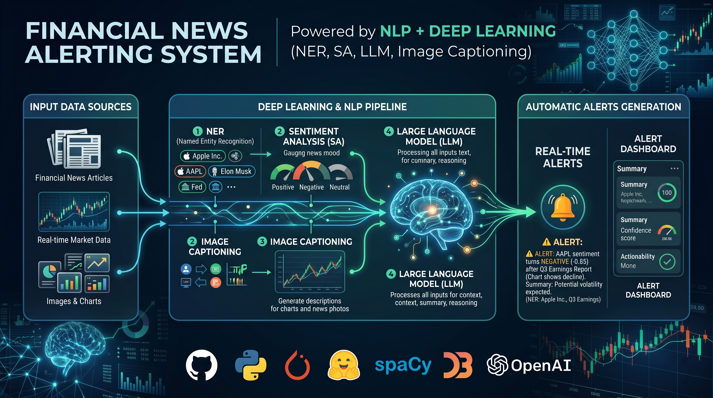

# Financial News Alert System

**Development period:** January–May 2026

End-to-end NLP + DL system for financial news alert generation.

Given a news text (and optionally a chart image), the project extracts named entities, predicts sentiment, and produces a final alert using either rule-based logic or an LLM.

## Which README should I use?

- `Quickstart_README.md`: fastest path for inference with existing checkpoints (minutes).
- `Reproducibility_README.md`: full rebuild path (dataset + training + evaluation), longer run.

If you just cloned the repo and want to test quickly, start with `Quickstart_README.md`.

## What the project contains

- **NER model**: BiLSTM + CRF (`models/bilstm_ner.py`)
- **Sentiment model**: BiLSTM with attention (`models/bilstm_sa.py`)
- **Joint model**: shared encoder for NER + sentiment (`models/shared_encoder.py`)
- **Optional image captioning**: DePlot + Qwen (`models/deplot.py`)
- **End-to-end inference**: `pipeline.py`
- **Batch inference over `input/` samples**: `batch_eval.py`
- **Training scripts**: `training/train_ner.py`, `training/train_sa.py`, `training/train_joint.py`

## Repository map

```text
.
|- assets/
|  |- readme.png                 # pipeline diagram shown at the top of this README
|- checkpoints/                  # trained weights: ner_best.pt, sa_best.pt, joint_best.pt, vocab_info.pt
|- configs/
|  |- config.yaml                # paths, hyperparameters and pipeline flags
|- data/
|  |- dataset.py                 # dataset builder (FiNER-ORD + FinBERT labels) and DataLoaders
|                                # (GloVe and the generated .jsonl are not tracked; see Reproducibility_README.md)
|- experiments/
|  |- news.py                    # custom text / image path to edit
|  |- run_news.py                # runs the pipeline on news.py
|- input/                        # 10 demo samples (p1-p10), each with a .txt and a chart .png
|- models/
|  |- bilstm_ner.py              # BiLSTM-CRF for NER
|  |- bilstm_sa.py               # BiLSTM with attention for sentiment
|  |- shared_encoder.py          # shared encoder for the joint NER + SA model
|  |- deplot.py                  # DePlot + Qwen chart captioner
|  |- local_llm.py               # local Qwen model wrapper
|  |- captioning_CNN_LSTM.py     # experimental CNN+LSTM captioner (not used in the pipeline)
|- results/                      # training histories, joint-vs-separate comparison, lambda search, batch_eval*.json
|- training/
|  |- train_ner.py
|  |- train_sa.py
|  |- train_joint.py             # joint training + lambda ablation
|- batch_eval.py                 # multi-sample batch evaluation over input/
|- evaluate.py                   # NER / SA / joint model evaluation
|- pipeline.py                   # end-to-end inference entrypoint
|- run_all.sh                    # full reproduction script
|- Final_Paper.pdf               # project report
|- Quickstart_README.md          # quick inference guide
|- Reproducibility_README.md     # full reproducibility guide
|- requirements.txt
```

## Typical workflows

- **Quick demo**: run sample or custom news with pretrained checkpoints (`Quickstart_README.md`).
- **Research/reproduction**: rebuild data and retrain all models (`Reproducibility_README.md`).

## Notes

- CPU-only execution is supported.
- If CUDA is detected but unusable on your machine, set:

```bash
export CUDA_VISIBLE_DEVICES=""
```

## Authors

- Andrés Gil Vicente
- Liam Esgueva González
- Jorge Carnicero Príncipe
- Jorge González Pérez